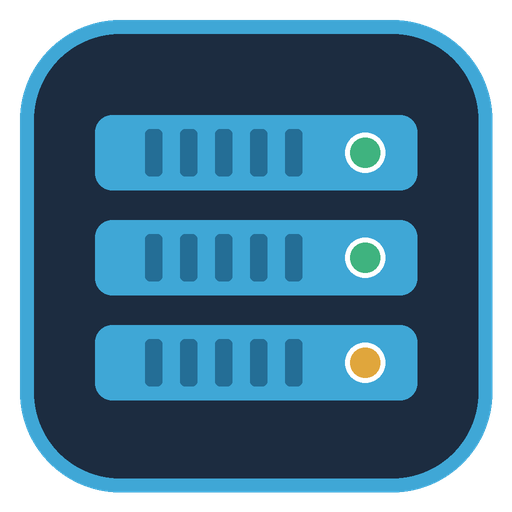
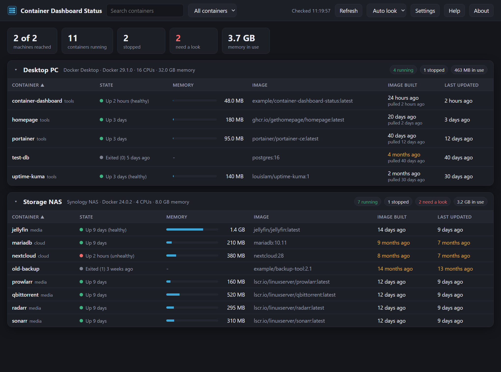
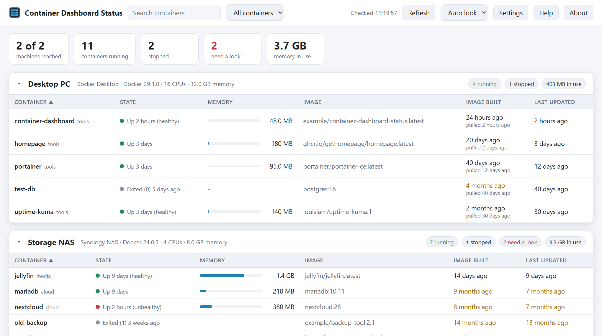
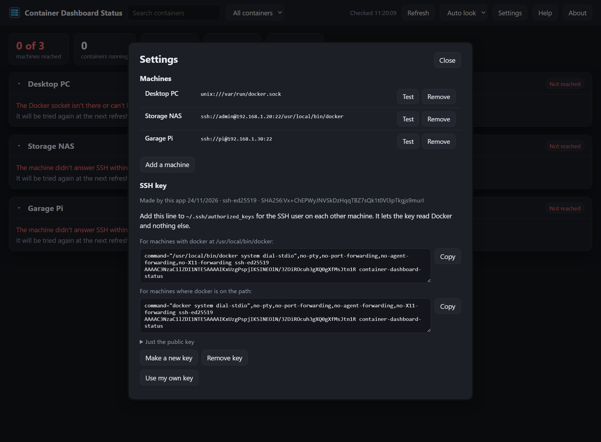

<p align="center">
  
</p>

# Container Dashboard Status

A read-only web page showing which Docker containers run on each of your machines, how much memory they use and when they were last updated, run in Docker.


Container Dashboard Status reads the Docker Engine of each machine you add (this one through its socket, others over SSH with a key it makes for you) and shows them all on one page that refreshes itself. It only looks: it never starts, stops, pulls or changes anything.

## ✨ Features

- **Every machine on one page**: a card per machine with its operating system, Docker version, CPUs and memory, and how many containers are running, stopped or need a look.
- **Each container at a glance**: state (running, healthy, unhealthy, paused, restarting, stopped), compose project, memory in use with a bar for its share of the machine, and the image.
- **When it was last updated**: when the image was built by its publisher (and pulled, where the machine records it), and when the container was last made, which is when it was last updated or re-created. Anything over 90 days old is shown in amber.
- **Totals**: machines reached, containers running and stopped, ones that need a look, and memory in use across everything.
- **Find and sort**: search by container, image or project; show only running, stopped or problem containers; sort by any column.
- **Refreshes itself** every 30 seconds (or as often as you set), with a **Refresh** button to check at once. However many browsers have it open, each machine is asked only once per refresh.
- **Machines and the SSH key in Settings**: add, test and remove machines on the page. The app makes its own SSH key (or takes one you paste) and shows the line to add to each machine's `authorized_keys`, which lets the key read Docker and nothing else. The key is stored encrypted and never shown again. No passwords, and no extra container on the other machine. Works with Synology NAS, Linux servers and Raspberry Pis.
- **Read-only by design**: only GET requests are sent to Docker, and this machine's socket is mounted read-only.
- **Sign-in**: one username and password, a lockout after 10 wrong passwords in 15 minutes.
- Light and dark looks (or as the browser), Help and About, and `GET /healthz` for Docker and uptime monitors.

## 🖼️ Screenshots







## 📋 Requirements

- Docker with Docker Compose v2 (Docker Desktop on Windows, or Docker Engine on Linux or a NAS)
- For other machines: SSH turned on, with Docker usable by the SSH user (see [Setting up a machine for SSH](#setting-up-a-machine-for-ssh))
- To run without Docker: Node.js 22.12 or later

## 📦 Installation

1. Put `docker-compose.yml` and `.env.example` from this repository in a folder on the Docker host (or clone the repository).
2. Copy `.env.example` to `.env` in the same folder and set `APP_USERNAME`, `APP_PASSWORD` and `SESSION_SECRET` (see Configuration below).
3. Start it from that folder:

   ```
   docker compose up -d
   ```

   This pulls `jason4bury/container-dashboard-status` from Docker Hub. To build the image yourself, run `docker build -t jason4bury/container-dashboard-status .` in this repository first.
4. Open `http://<your-server>:3040` and sign in. The machine it runs on is already there.
5. To add other machines, open **Settings**, press **Make a key**, add the line it shows to each machine (see [Setting up a machine for SSH](#setting-up-a-machine-for-ssh)), then **Add a machine**.

To use a different port on the host, change the first number in `"3040:3040"` in `docker-compose.yml`.

**Updating:** `docker compose pull` then `docker compose up -d`.

## 🚀 Usage

- **Settings** adds, tests and removes machines, and makes or takes the SSH key. `http://<your-server>:3040/#settings` opens it straight away.
- Each machine's card shows its containers. Click a card's title bar to fold it away; it stays folded next time.
- Type in the search box, or pick **Running**, **Stopped** or **Problems** to narrow the list. Problems are containers that are unhealthy, restarting or dead, or stopped with an error.
- Click a column heading to sort by it, and again to reverse.
- Hover over a date for the day itself, or over a memory bar for its share of the machine's memory.
- A machine that can't be read shows what went wrong on its card, and is tried again at the next refresh.

## ⚙️ Configuration

The machines and the SSH key are added in **Settings** on the page. The port is set in `docker-compose.yml`, and the other settings live in `.env` next to it, which the compose file passes to the container. `.env` is gitignored; `.env.example` shows every setting.

| Setting | Required | What it does |
| --- | --- | --- |
| `APP_USERNAME`, `APP_PASSWORD` | Yes | The sign-in account |
| `SESSION_SECRET` | Yes | Random string of 32+ characters that signs the sign-in cookie and encrypts the saved SSH key. Change it and you'll need to add the key again |
| `REFRESH_SECONDS` | | How often the page checks again (default 30, at least 10) |
| `HOSTS` | | The machines to show at first, until any are added in Settings: comma-separated `Name=address` |
| `SSH_FINGERPRINTS` | | Only trust machines whose SSH host key has one of these fingerprints |

The app refuses to start if the sign-in settings are missing or still the example values, and says which one in `docker compose logs container-dashboard-status`.

### Kinds of machine

**Add a machine** in Settings builds the address for you. In `HOSTS` you write it yourself:

| Address | For |
| --- | --- |
| `unix:///var/run/docker.sock` | The machine the dashboard runs on (the socket mounted in `docker-compose.yml`) |
| `ssh://user@address:port` | Another machine, over SSH with a key |
| `ssh://user@address:port/usr/local/bin/docker` | The same, where `docker` isn't on the SSH path (Synology) |
| `http://address:2375` | A read-only [Docker socket proxy](https://github.com/Tecnativa/docker-socket-proxy) with `CONTAINERS=1` and `IMAGES=1` |
| `npipe:////./pipe/docker_engine` | Docker Desktop on Windows, when running without Docker |

### Setting up a machine for SSH

1. In **Settings**, press **Make a key**. (Or press **Use my own key** and paste a private key you already use, with its passphrase if it has one.)
2. Press **Copy** beside the line Settings shows, and add it on its own line to `~/.ssh/authorized_keys` for the SSH user on the other machine.
3. Make sure that user can use Docker: `ssh user@address docker version` should work without `sudo`. On Linux add the user to the `docker` group. On a Synology NAS, turn on SSH (Control Panel > Terminal & SNMP) and the user home service (Control Panel > User & Group > Advanced), use an administrator account, and if Docker says permission denied run once on the NAS: `sudo synogroup --add docker <user>` then `sudo chown root:docker /var/run/docker.sock`.

4. Back in Settings, **Add a machine**: pick *Another machine, over SSH with a key*, fill in its name, address, port and user (and the docker path, `/usr/local/bin/docker` on a Synology), press **Test**, then **Add**.

**Why the line starts with `command=`.** The dashboard only ever asks Docker for information, and the `command="... system dial-stdio",no-pty,...` part of the line Settings gives you stops the key doing anything else on that machine, even if someone copied it. If you paste a key you also use yourself, add its plain public key instead, or that key will be limited too.

**Where the key is kept.** In the app's data folder (the `cds-data` volume), encrypted with `SESSION_SECRET`. Settings shows only the public half. A key file can also be given with `SSH_KEY` (and `SSH_KEY_PASSPHRASE`); it's used when no key has been added in Settings.

### Putting it on the internet

- Keep it on your home network if you can; it shows what runs on your machines. For access from outside, a WireGuard or Tailscale tunnel is safest.
- Otherwise put it behind a reverse proxy with HTTPS (Nginx Proxy Manager, Caddy, Traefik, Synology) rather than forwarding the port from your router, and use a strong `APP_PASSWORD`. The sign-in cookie is marked secure automatically when the proxy forwards HTTPS.

### Running without Docker

Install Node.js 22.12+, run `npm ci --omit=dev --omit=optional`, set the settings in `.env` and start it with `npm start`. Add this PC as `npipe:////./pipe/docker_engine` for Docker Desktop on Windows. Settings are kept in `./data` unless `DATA_DIR` is set, and it listens on port 3040 unless `PORT` is set.

### Project layout

```
server/
  index.js     Express app, start-up checks, security headers, /api/status
  auth.js      sign-in, sign-out and lockout
  docker.js    reads each machine's Docker (socket, SSH or proxy), GET requests only
  store.js     the machines and the encrypted SSH key, kept in DATA_DIR
  version.js   shows package.json's version as v1.00
public/        the page (index.html, login.html, css/, js/app.js, js/settings.js, icons)
assets/        icon and README image
docs/          screenshots
```

Run `npm run lint` (ESLint) before committing.

## 📝 Changelog

See [CHANGELOG.md](CHANGELOG.md).

## 📄 Licence

MIT, see [LICENSE](LICENSE). Copyright (c) 2026 Jason Rhodes.

Created by Jason Rhodes, built with Claude (Anthropic).
